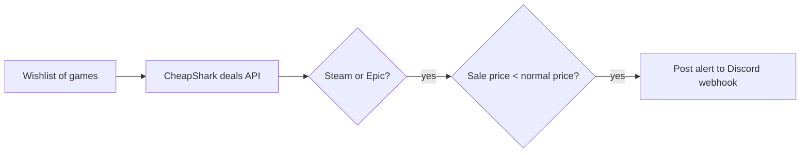

# 🎮 Video Game Deal Tracker

A Python script that watches a wishlist of PC games and sends a **Discord alert** when any of them go on sale on **Steam** or the **Epic Games Store**.


## Overview

Checking store pages by hand for price drops is tedious. This tool automates it: give it a list of games, and it looks up current prices across stores and posts a message to a Discord channel whenever a game on the list is discounted.

## How it works



1. Loops through each title in the wishlist.
2. Requests deals for that exact title from the [CheapShark API](https://apidocs.cheapshark.com/).
3. Keeps only results from Steam and the Epic Games Store.
4. Compares the sale price against the normal retail price.
5. If the game is discounted, sends a formatted message to Discord through a webhook.

### Example alert

```
Hollow Knight is on sale on Steam!
Sale Price: 7.49
RetailPrice: 14.99
```

## Tech stack

- **Python 3**
- **requests** for HTTP calls
- **CheapShark API** for game prices across stores
- **Discord webhooks** for notifications

## Getting started

### 1. Clone and install

```bash
git clone https://github.com/jackluehrs/VideoGameDealTracker.git
cd VideoGameDealTracker
pip install requests
```

### 2. Add your Discord webhook

Create a webhook in your Discord server (**Server Settings → Integrations → Webhooks**), then use **one** of these options:

**Option A: config file**

```bash
cp discord_webhook.example.py discord_webhook.py
# then paste your webhook URL into discord_webhook.py
```

**Option B: environment variable**

```bash
export DISCORD_WEBHOOK_URL="your-webhook-url"         # macOS / Linux
$env:DISCORD_WEBHOOK_URL="your-webhook-url"           # Windows PowerShell
```

`discord_webhook.py` is listed in `.gitignore`, so your real URL never gets committed.

### 3. Edit your wishlist and run

Update the `gameList` in `GameLookUp.py` with the games you want to track, then run:

```bash
python GameLookUp.py
```

## Project structure

| File | Purpose |
| --- | --- |
| `GameLookUp.py` | Main script: price lookup, filtering, and Discord alerts |
| `discord_webhook.example.py` | Template for your private webhook config |
| `.gitignore` | Keeps secrets and Python build files out of the repo |

## Design highlights

- **REST API integration:** builds query parameters, sends a custom User-Agent, and checks both the status code and the response shape before using the data.
- **Secrets management:** the webhook URL is loaded from an environment variable or a git-ignored config file, never hardcoded.
- **Error handling:** failed lookups and network errors are reported clearly instead of crashing the script.

## Roadmap

- [ ] Load the wishlist from a file instead of hardcoding it
- [ ] Run automatically on a schedule (e.g., GitHub Actions)
- [ ] Skip duplicate alerts for a sale that was already reported
- [ ] Support more stores

## Author

Built by [Jack Luehrs](https://github.com/jackluehrs).
